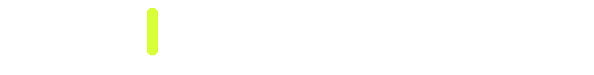
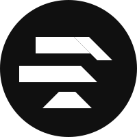

<div align="center">
  <picture>
    <source media="(prefers-color-scheme: dark)" srcset="assets/banner-v5-dark.gif">
    
  </picture>
</div>

## The display typeface for developers who ship taste.

An all-caps grotesque built for terminals, editors, launch pages and loud brand systems. Drawn as a hand-cut 61×61 bitmap alphabet, then rebuilt as **exact 0°/90°/45° lattice vectors** — every edge ruler-straight, no curves, no blur, infinitely sharp from a smartwatch to a billboard.

Caps-only by design; lowercase maps to caps. Free forever under the SIL Open Font License.

<picture>
  <source media="(prefers-color-scheme: dark)" srcset="assets/h-skins-dark.svg">
  
</picture>

One skeleton, five ways to wear it — all five share the same underlying geometry:

| Theme | What it is | Files |
| --- | --- | --- |
| **RON Black** | The flagship. Heavy chamfered caps, cut from the original bitmap art. | [`RON-Black.otf`](dist/RON-Black.otf) · [`RON-Black.woff2`](dist/RON-Black.woff2) |
| **RON Mono** | Same outlines, fixed 980-unit advances — terminals and code. | [`RON-Mono.otf`](dist/RON-Mono.otf) · [`RON-Mono.woff2`](dist/RON-Mono.woff2) |
| **RON Dot** | Braille / dot-matrix halftone of the same alphabet. | [`RON-Dot.otf`](dist/RON-Dot.otf) · [`RON-Dot.woff2`](dist/RON-Dot.woff2) |
| **RON Scan** | CRT scanlines clipped to the RON skeleton. | [`RON-Scan.otf`](dist/RON-Scan.otf) · [`RON-Scan.woff2`](dist/RON-Scan.woff2) |
| **RON Outline** | The ring only — hollow stencil silhouette. | [`RON-Outline.otf`](dist/RON-Outline.otf) · [`RON-Outline.woff2`](dist/RON-Outline.woff2) |

Open [`dist/specimen.html`](dist/specimen.html) in any browser for the full specimen. Set in RON, obviously.

<picture>
  <source media="(prefers-color-scheme: dark)" srcset="assets/h-get-dark.svg">
  
</picture>

**Desktop (Windows):** grab any `.otf` from [`dist/`](dist/) → right-click → Install.
**macOS:** open it in Font Book → Install Font.
**Web:**

```css
@font-face {
  font-family: 'RON Black';
  src: url('RON-Black.woff2') format('woff2');
  font-display: swap;
}
.hero { font-family: 'RON Black', sans-serif; }
```

**From source:**

```bash
cd build
npm install
node build.js     # rebuilds every font in dist/ from the source bitmaps
node braille.js "SHIP IT"   # BONUS: render any text as Unicode braille in RON
```

<picture>
  <source media="(prefers-color-scheme: dark)" srcset="assets/h-spec-dark.svg">
  
</picture>

| | |
| --- | --- |
| Outlines | Exact H / V / 45° lattice, CFF (cubic Bézier) |
| Units per em | 1000 |
| Cap height | 620 |
| Ascender / descender | 810 / −280 |
| Weight class | 900 (Black) |
| Advances | Proportional (RON Mono is fixed 980) |
| Glyphs | 82 per theme — A–Z, 0–9, `. , ! / * " & # : ; [ ] ( ) - _`, `'`, lowercase → caps |
| Formats | `.otf` · `.woff2` |
| Vendor | ROND · RON Type |
| License | SIL Open Font License 1.1 |
| Not yet drawn | `@ = % ?` — PRs welcome |

<picture>
  <source media="(prefers-color-scheme: dark)" srcset="assets/h-updates-dark.svg">
  
</picture>

**Ron gets updates — soon, and often.** This is a living font, not a frozen artifact, and updates and upgrades will land in a short period of time. The font will be cleaned further and more fixes will be made, on a rolling basis:

- **Cleaner outlines, smaller files** — another pass of node reduction and outline tightening is already scheduled.
- **More fixes** — every glyph that looks off at your size gets patched in the next drop. Report it, and it gets fixed.
- **Kerning & hinting** — still on the roadmap, and still happening; they ship after the cleanup pass.
- **The four missing glyphs** — `@ = % ?` are next in line.
- **Visible drops, not silence** — every update lands in this repo. Watch it or star it and you'll see them ship.

<picture>
  <source media="(prefers-color-scheme: dark)" srcset="assets/h-contributors-dark.svg">
  
</picture>

| Who | What they built |
| --- | --- |
| [@DERYK-RYLOY](https://github.com/DERYK-RYLOY) | Original design · master geometry · build pipeline · this README |

That's the full roster today. Ron is open source — if you fix a glyph, add a kerning pair, or draw one of the missing four, you're a contributor. Open an issue or send a PR; credit gets given, never taken.

<picture>
  <source media="(prefers-color-scheme: dark)" srcset="assets/h-license-dark.svg">
  
</picture>

Ron is free under the [SIL Open Font License 1.1](LICENSE): use it in commercial products, embed it in apps, fork it, build on it. You can't sell the font files by themselves, and derivatives must stay under the OFL. If Ron shows up in the hands of a million developers shipping tasteful software — that's the entire point.

**Reserved Font Name:** none today. If Ron derivatives start appearing, the only candidate worth reserving later is `RON` itself.

---

<div align="center">

**RON TYPE** — drawn from a 61×61 hand-cut alphabet · traced exact · set in RON

[`dist/`](dist/) · [`build/`](build/) · [`bitmaps/`](bitmaps/) · [`specimen.html`](dist/specimen.html) · [`LICENSE`](LICENSE)

</div>

<div align="center">



<sub><b>SPECIAL THANKS — BLACKBOX GRAFX</b> · Freelance Concept Artist</sub><br>
<sub>His art is what inspired RON — the vision behind this alphabet.</sub>

</div>
